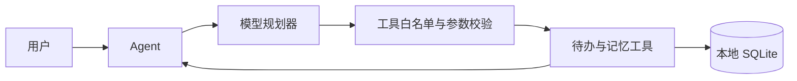

# AI-Resources · PocketPilot 个人智能体

一个给初学者展示的 Python 个人智能体：用户用自然语言提需求，模型选择一个允许的工具，程序验证参数并执行，再把结果反馈给用户。待办和长期记忆存在本地 SQLite 中，重启后仍可读取。

这是 `AI-Resources` 仓库中“了解并协助个人生活”的第一个可运行原型。

**亮点：**工具白名单、参数校验、最多三步的执行循环、本地持久化、无需密钥的离线演示、可切换模型服务。程序不会运行任意 shell 命令，也不会上传本地数据库。



## 一分钟运行

需要 Python 3.10+，无需安装第三方包。在仓库目录执行：

```powershell
python -m pocketpilot demo
```

依次输入 `添加待办 买牛奶`、`查看待办`、`记住 我喜欢咖啡`、`回忆 咖啡`。再次启动后仍能看到数据。演示规划器是规则程序，**并非真实大模型**；它用于在没有 API Key 时验证完整工具链。

## 接入真实模型

本项目使用通用的 Chat Completions 兼容接口。设置服务商提供的地址、密钥和模型名：

```powershell
$env:MODEL_BASE_URL="https://你的服务商地址/v1"
$env:MODEL_API_KEY="你的密钥"
$env:MODEL_NAME="你的模型名"
python -m pocketpilot chat
```

环境变量只对当前终端有效。不要把密钥写进仓库。服务商可能收费，按其控制台设置预算。

## 支持的工具

| 工具 | 作用 | 是否修改数据 |
| --- | --- | --- |
| `add_task`、`list_tasks`、`complete_task` | 添加、查看、完成待办 | 添加/完成会修改 |
| `remember`、`recall`、`forget` | 保存、查找、删除个人记忆 | 保存/删除会修改 |

模型只负责提出工具调用；`Agent.run_tool` 负责校验并执行。记忆内容是数据，不应被当成指令。真实模型的输出仍可能出错，程序会拒绝未知工具和无效参数。

## 测试

```powershell
python -m unittest discover -s tests -v
```

## 面试/比赛介绍（30 秒）

> 我做了一个可审计的个人智能体。它把大模型的意图转换为受限的工具调用，用 SQLite 保存待办和用户明确要求保存的记忆。工具白名单与参数校验防止模型直接执行任意命令；离线演示模式让评委无需密钥也能检查完整流程。

## 已知限制

- 这是本机单用户原型，没有账户、云同步或网页界面。
- 真实模型需要自行配置兼容的服务端点；不同服务商的兼容程度可能不同。
- SQLite 文件可能包含私人信息，默认被 `.gitignore` 排除。删除数据库文件即可清空全部本地数据。

MIT License · 2026 blinkunsu
